# Hệ thống giám sát Endpoint tích hợp phản ứng sự cố tự động và quản lý ticket

> Pipeline SOC thu nhỏ bằng công cụ mã nguồn mở: **Wazuh** (SIEM/XDR) phát hiện, **Shuffle** (SOAR) điều phối, **DFIR-IRIS** quản lý case, **Telegram Bot** xác nhận của quản trị viên (human-in-the-loop) trước khi **Wazuh Active Response** ngăn chặn.

| | |
|---|---|
| **Công nghệ** | Wazuh · Shuffle SOAR · DFIR-IRIS · Telegram Bot · Ubuntu Server · Kali Linux · Hydra · auditd · iptables · VMware |


---

## 1. Tóm tắt

Trong SOC thực tế, nhân viên phải thu thập thủ công thông tin từ nhiều công cụ rời rạc khi có cảnh báo, vừa chậm vừa dễ bỏ sót. Dự án xây dựng một luồng xử lý khép kín: Wazuh phát hiện hành vi bất thường trên endpoint Ubuntu, gửi cảnh báo qua Webhook sang Shuffle; Shuffle tự động tạo case và các task phân công trên DFIR-IRIS, sau đó hỏi quản trị viên qua Telegram; khi được duyệt, Shuffle gọi Wazuh Active Response để ngăn chặn.

Hệ thống được kiểm thử với **2 kịch bản tấn công** và xử lý thành công cả hai:

| Kịch bản | Phát hiện | Phản ứng sau khi quản trị viên duyệt |
|---|---|---|
| **SSH Brute Force** (Hydra từ Kali Linux) | Rule `5763` (level 10) | Chặn IP tấn công bằng `iptables` (firewall-drop) |
| **Webshell** | 3 lớp rule tương quan do nhóm tự viết: `100500` + `100510` → `100520` (level 15) | Khóa quyền ghi web root, dừng Apache2 |

## 2. Mục tiêu và phạm vi

**Mục tiêu**
- Tự động hóa chuỗi: phát hiện → tiếp nhận cảnh báo → tạo case → thông báo → phản ứng.
- Chuẩn hóa việc ghi nhận sự cố: mỗi cảnh báo sinh một case kèm bộ task theo vòng đời xử lý sự cố.
- Giữ con người trong vòng kiểm soát với các hành động có thể gây gián đoạn dịch vụ.

**Phạm vi:** môi trường lab nhỏ (1 endpoint Ubuntu, 2 VM), 2 kịch bản tấn công. Chưa bao gồm threat intelligence, ransomware/APT, kiểm thử tải.

## 3. Kiến trúc hệ thống

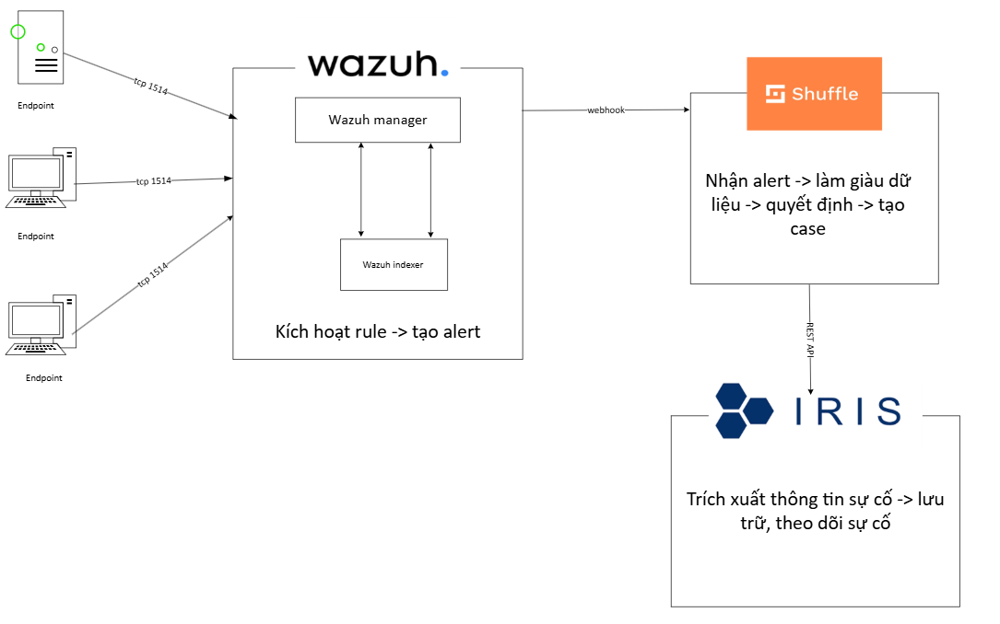
*Hình 1. Luồng dữ liệu: Endpoint → Wazuh (TCP 1514) → Webhook → Shuffle → REST API → DFIR-IRIS.*

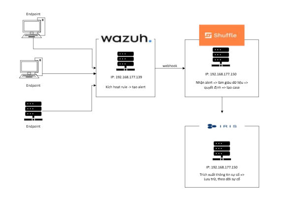
*Hình 2. Mô hình lab: máy Wazuh và máy Shuffle + DFIR-IRIS.*

**Tài nguyên lab (VMware, card mạng NAT)**

| Máy | CPU | RAM | Disk | Vai trò |
|---|---|---|---|---|
| Ubuntu Server 1 | 2 core | 4 GB | 80 GB | Wazuh Manager / Indexer / Dashboard |
| Ubuntu Server 2 | 2 core | 8 GB | 80 GB | Shuffle SOAR + DFIR-IRIS |
| Kali Linux | | | | Máy tấn công mô phỏng (Hydra) |

**Vai trò từng thành phần**

| Thành phần | Vai trò |
|---|---|
| Wazuh | Thu thập log, FIM, rule engine, sinh cảnh báo; thực thi Active Response |
| Shuffle | Nhận Webhook, điều phối workflow, hỏi duyệt qua User Input, gọi API |
| DFIR-IRIS | Lưu case, task, ghi chú và vết điều tra |
| Telegram Bot | Gửi cảnh báo, nhận quyết định Approve/Deny của quản trị viên |

## 4. Luồng xử lý (áp dụng cho cả 2 kịch bản)

1. **Phát hiện:** Wazuh Agent gửi log về Manager, rule khớp thì sinh alert.
2. **Kích hoạt:** Alert được đẩy sang Shuffle qua Webhook.
3. **Tạo case:** Shuffle gọi REST API của DFIR-IRIS để tạo case (tiêu đề, mức độ, Rule ID, agent) và tự động thêm bộ task: *Alert Validation, Investigate Source, Scope Assessment, Collect Indicators, Containment, Eradication, Recovery, Lessons Learned*, gán cho hai vai trò **Analyst** và **Incident Responder**.
4. **Hỏi duyệt (human-in-the-loop):** Shuffle gửi tin nhắn Telegram kèm 2 nút *Đồng ý / Từ chối*.
5. **Phản ứng:** Nếu đồng ý, Shuffle gọi Wazuh Active Response; nếu từ chối, workflow dừng.
6. **Cập nhật:** Gửi trạng thái "Đã xử lý case" lên Telegram và ghi chú vào case trên DFIR-IRIS.

## 5. Kịch bản 1: SSH Brute Force

**Mô phỏng.** Từ máy Kali, dùng Hydra thử 15 mật khẩu vào tài khoản SSH của endpoint (`webserver`):

```bash
hydra -l <user> -P wordlist.txt -t 1 -f ssh://<IP_endpoint>
```

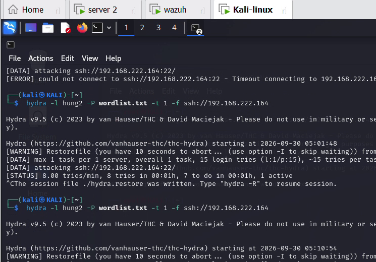
*Hình 3. Chạy Hydra từ Kali Linux (VMware) vào endpoint.*

**Phát hiện.** Chuỗi sự kiện `PAM: User login failed (5503)` → `sshd: authentication failed (5760)` được Wazuh nâng thành cảnh báo **Rule 5763, level 10**: *sshd: brute force trying to get access to the system*.

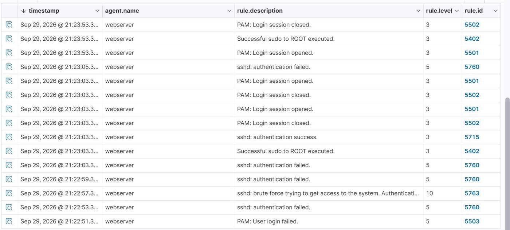
*Hình 4. Chuỗi cảnh báo trên Wazuh Dashboard; Rule 5763 xuất hiện sau các lần đăng nhập thất bại.*

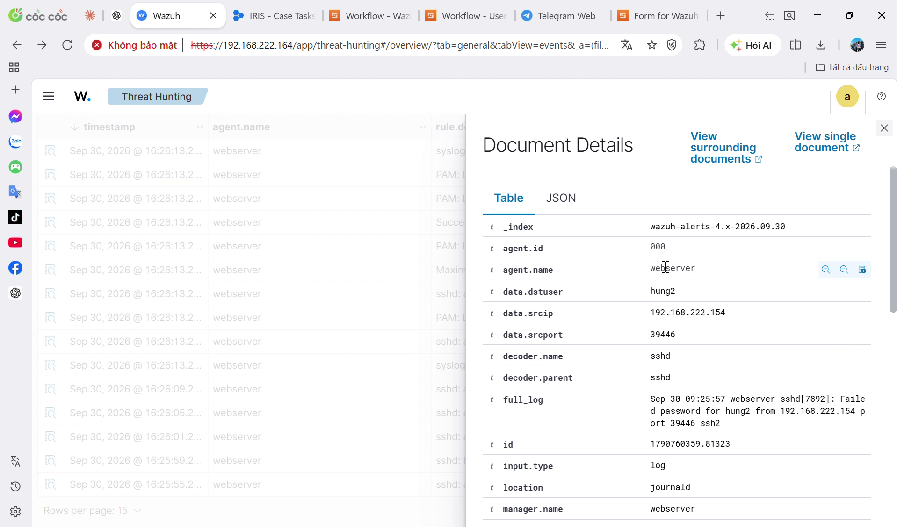
*Hình 5. Chi tiết alert: agent, IP nguồn, `full_log`, mô tả rule.*

**Tự động hóa.** Workflow Shuffle gồm: Webhook (Wazuh alert) → Repeat alert → Create case (DFIR-IRIS) → User Input → Active Response → Telegram + Add note.

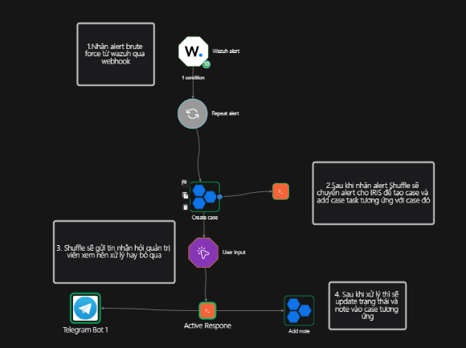
*Hình 6. Workflow Shuffle xử lý brute force.*

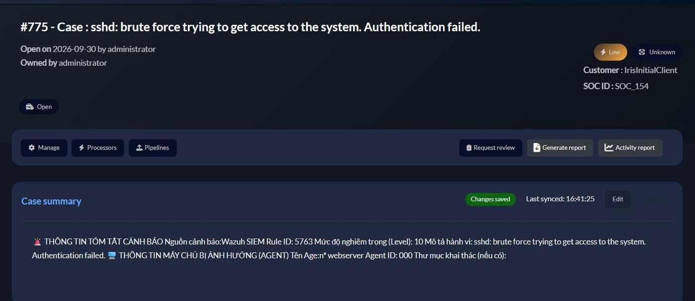
*Hình 7. Case tạo tự động trên DFIR-IRIS, tóm tắt gồm nguồn cảnh báo, Rule ID, level và agent.*

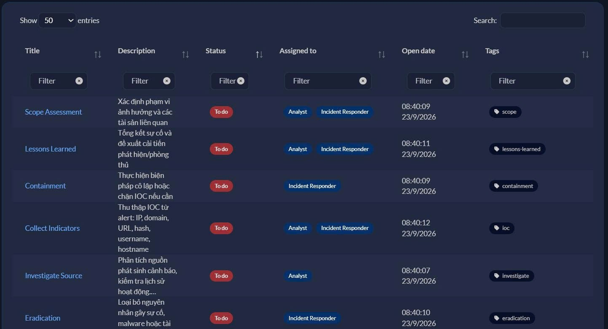
*Hình 8. Các task được gán cho Analyst và Incident Responder.*

**Xác nhận và ngăn chặn.**

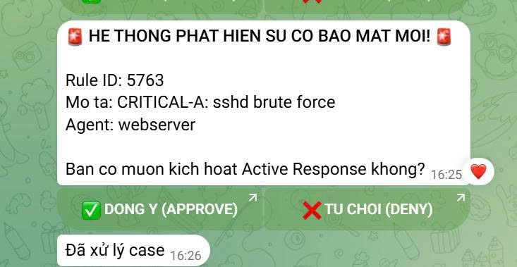
*Hình 9. Telegram hỏi quản trị viên; sau khi bấm "Đồng ý", bot trả "Đã xử lý case".*

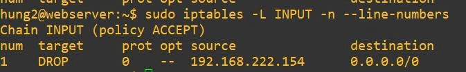
*Hình 10. IP của máy tấn công bị `DROP` trong chain INPUT sau Active Response.*

Chi tiết điều tra: [incident-reports/ssh-brute-force.md](incident-reports/ssh-brute-force.md)

## 6. Kịch bản 2: Webshell (phát hiện đa tầng, rule tự viết)

**Mô phỏng.** Do hạn chế tài nguyên, nhóm đặt webshell và gọi lệnh ngay trên máy chủ web (thực tế sẽ thực hiện từ máy khác):

```bash
echo '<?php system($_GET["cmd"]); ?>' > /var/www/html/t_corr.php   # tạo webshell
curl "http://localhost/t_corr.php?cmd=whoami"                          # thực thi trong 300s
sudo tail -f /var/ossec/logs/alerts/alerts.json \
  | jq 'select(.rule.id == "100520")'                                  # theo dõi cảnh báo Wazuh
rm -f /var/www/html/t_corr.php                                         # xóa file Web Shell thử nghiệm, mục đích là dọn dẹp môi trường sau khi kiểm tra.
```

**Phát hiện: 3 lớp.**

| Lớp | Cơ chế | Rule |
|---|---|---|
| File | FIM realtime thư mục `/var/www/html`, bắt file PHP mới/bị sửa/chứa pattern webshell | `100500` (level 8), `100501` (level 10), `100502` (level 12) |
| Hành vi | `auditd` bắt `execve` của `www-data` (uid 33) | `100510` (level 12) |
| **Tương quan** | File PHP mới **và** `www-data` chạy lệnh trong 300 giây | `100520` (**level 15**, CRITICAL, độ tin cậy cao) |

Tất cả rule ánh xạ MITRE ATT&CK **T1505.003** (Server Software Component: Web Shell). Cấu hình đầy đủ: [`configs/wazuh/`](configs/wazuh/).

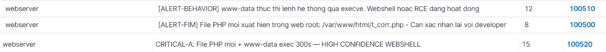
*Hình 11. Dashboard hiển thị các cảnh báo 100500, 100510 và rule tương quan 100520.*

**Tự động hóa.**

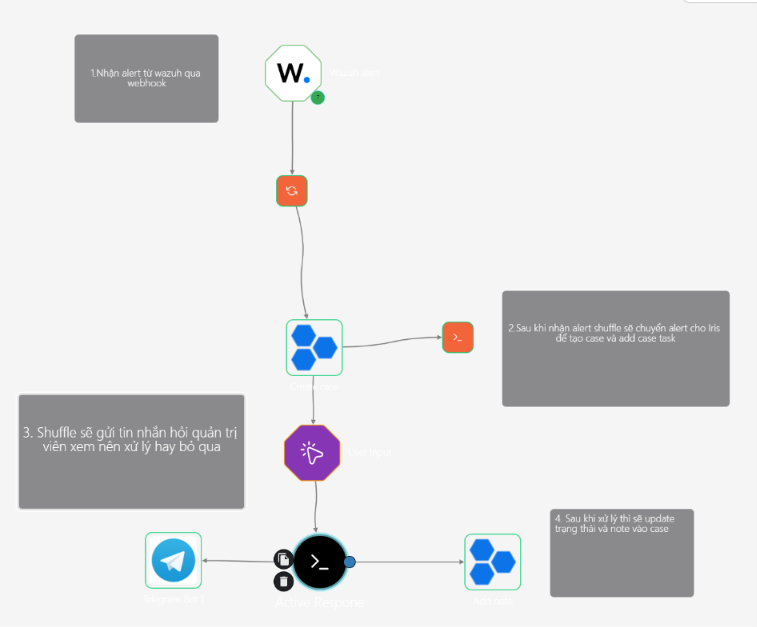
*Hình 12. Workflow Shuffle xử lý webshell (kích hoạt bởi Rule 100520).*

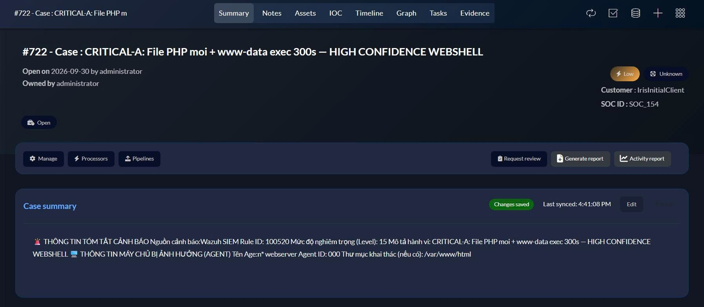
*Hình 13. Case DFIR-IRIS tạo tự động, thư mục khai thác `/var/www/html`.*

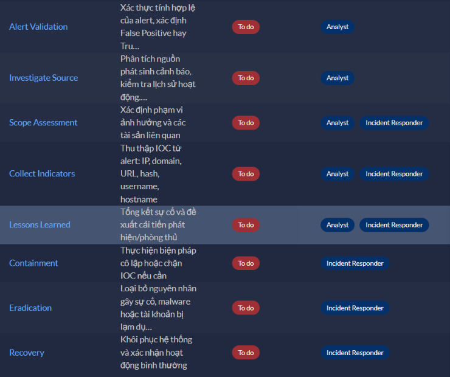
*Hình 14. 8 task theo vòng đời xử lý sự cố, gán cho Analyst và Incident Responder.*

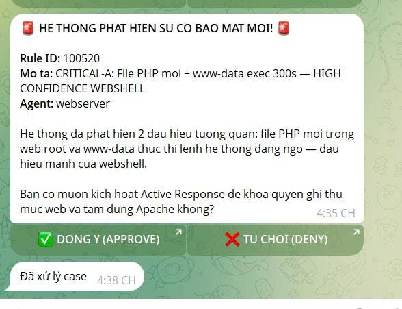
*Hình 15. Telegram hỏi duyệt trước khi khóa quyền ghi web root và tạm dừng Apache.*

**Phản ứng (Active Response, script tự viết).** Hai script trong [`configs/active-response/`](configs/active-response/): `mitre-m1018-lock-webdir` (`chmod -R a-w` thư mục web) và `mitre-m1042-suspend-service` (`systemctl stop apache2`).

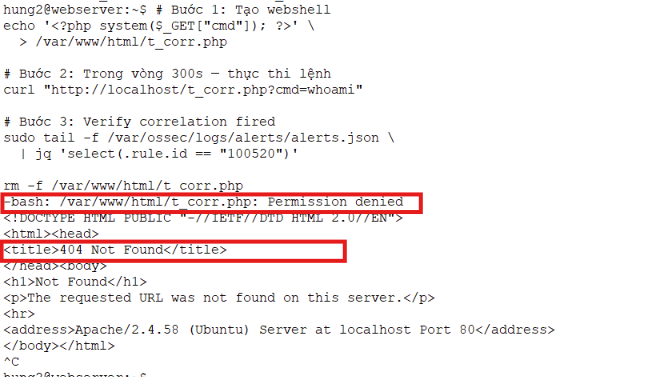
*Hình 16. Sau Active Response, thao tác `rm` file webshell bị từ chối (`Permission denied`), cho thấy quyền ghi đã bị khóa.*

Chi tiết điều tra: [incident-reports/web-shell.md](incident-reports/web-shell.md)

## 7. Kết quả

| Chỉ số | Kết quả |
|---|---|
| Kịch bản phát hiện và xử lý thành công | **2 / 2** |
| Rule phát hiện tự viết (webshell) | 5 rule (`100500`, `100501`, `100502`, `100510`, `100520`) |
| Active Response script tự viết | 2 |
| Task tự động tạo trên mỗi case | 8, gán theo 2 vai trò |
| Hành động phá hủy có xác nhận của quản trị viên | 100% (chặn IP, khóa web root, dừng dịch vụ) |
| Thời gian từ Telegram hỏi duyệt đến "Đã xử lý case" | ~1 phút (brute force), ~3 phút (webshell); gồm cả thời gian người duyệt, chỉ là số quan sát trong lab |

**Nhận xét.** Pipeline chạy xuyên suốt từ phát hiện đến ghi nhận và phản ứng mà không cần thao tác thủ công ở các bước trung gian; rule tương quan 100520 tăng độ tin cậy so với từng cảnh báo riêng lẻ.

**Demo video:** [Điền link YouTube/Drive (unlisted)]

## 8. Hạn chế và hướng phát triển

**Hạn chế**
- Quy mô lab nhỏ (1 endpoint), chưa đánh giá chịu tải.
- Mới 2 kịch bản; chưa có ransomware, APT, lateral movement.
- Hiệu quả phụ thuộc chất lượng rule Wazuh và logic workflow; chưa đo tỷ lệ cảnh báo giả.
- Chưa tích hợp Threat Intelligence; chưa có hàng đợi bền vững giữa các thành phần, có nguy cơ mất alert khi một dịch vụ gián đoạn.
- Phát hiện dựa trên luật, chưa có UEBA/ML.

**Hướng phát triển**
- Thêm enrichment (VirusTotal, MISP) vào workflow.
- Thêm message queue (RabbitMQ/Kafka) để tăng độ ổn định.
- Mở rộng playbook cho ransomware, phishing, lateral movement; tinh chỉnh rule giảm false positive.
- Thử nghiệm UEBA / AI-ML phân loại cảnh báo.

## 9. Bài học rút ra

- [Điền 2-3 ý của riêng bạn, ví dụ: khó khăn khi cấu hình Webhook Wazuh → Shuffle, cách viết rule tương quan, cách cho Telegram trả quyết định về Shuffle]

## 10. Cấu trúc repo

```
├── README.md
├── images/                      ảnh minh chứng
├── configs/
│   ├── wazuh/                   auditd, FIM, custom rules
│   └── active-response/         script phản ứng
└── incident-reports/            báo cáo sự cố từng kịch bản
```

## 11. Tài liệu tham khảo

- Wazuh: https://documentation.wazuh.com
- Shuffle: https://shuffler.io/docs
- DFIR-IRIS: https://docs.dfir-iris.org
- MITRE ATT&CK T1110, T1505.003: https://attack.mitre.org

---
> Dự án thực hiện trong môi trường lab cô lập, chỉ phục vụ học tập. Mọi cuộc tấn công mô phỏng nhắm vào hệ thống do nhóm sở hữu.
